

---

## 📊 Stats & Composition

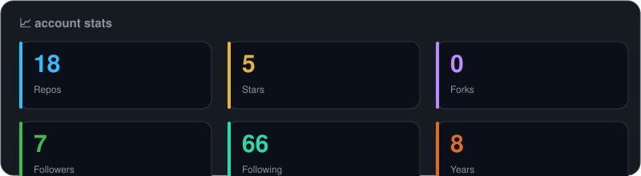


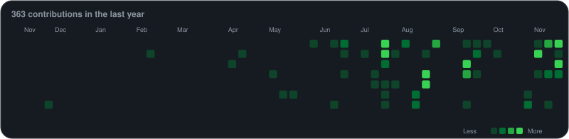

---

## 🐍 Contribution Snake

---

## 📡 Radar Scan

---

## 🎨 Animations

<table>
<tr>
<td align="center" width="400"></td>
<td align="center" width="400"></td>
</tr>
<tr>
<td align="center" width="400"></td>
<td align="center" width="400"></td>
</tr>
<tr>
<td align="center" width="400"></td>
<td align="center" width="400">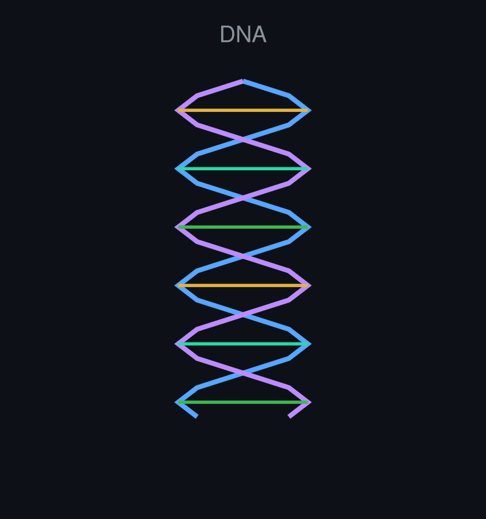</td>
</tr>
<tr>
<td align="center" width="400"></td>
<td align="center" width="400">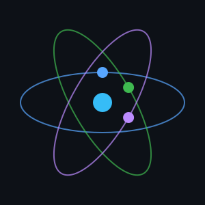</td>
</tr>
<tr>
<td align="center" width="400">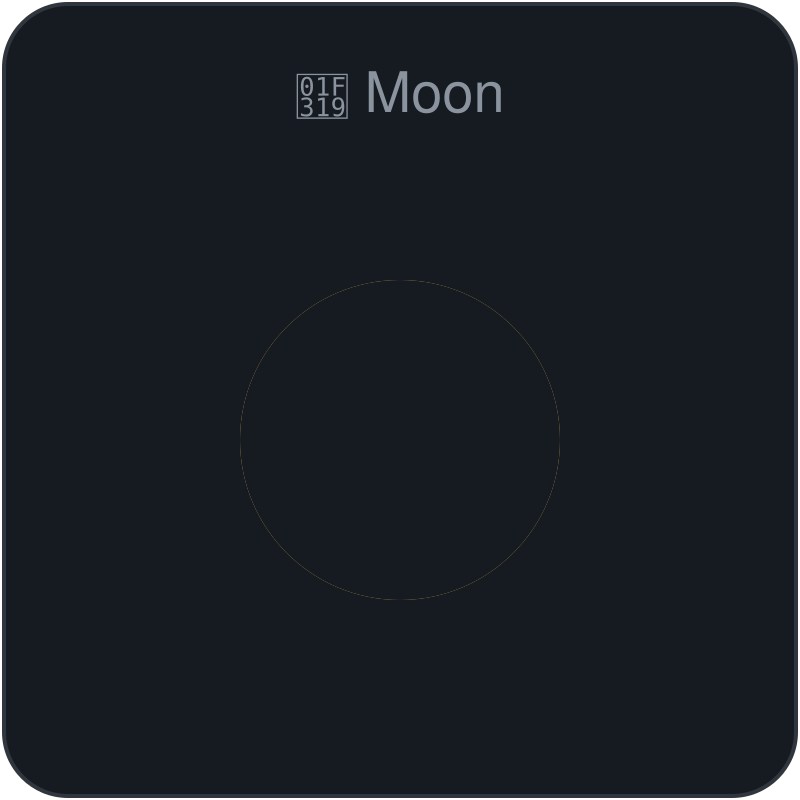</td>
<td align="center" width="400"></td>
</tr>
<tr>
<td align="center" width="400"></td>
<td align="center" width="400">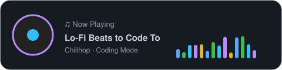</td>
</tr>
</table>

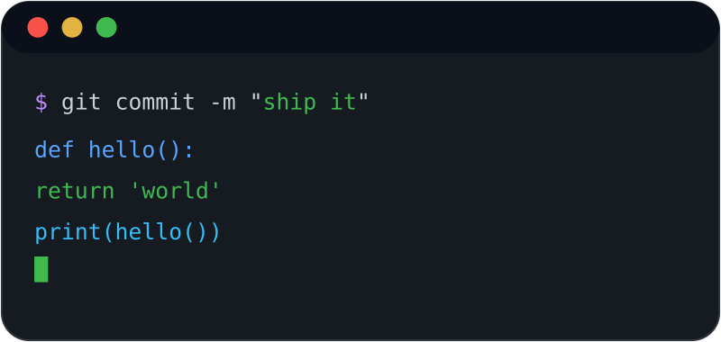


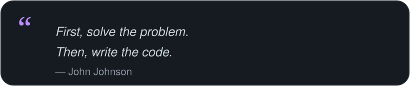

---

## 📦 Packages

---

