

# 👋 Hi, I'm **newnju**

**Full-Stack Developer · Open Source Enthusiast · AI/ML Explorer**

---

## 📡 Live Activity

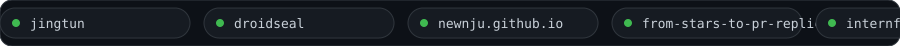

---

## 📊 Stats & Composition


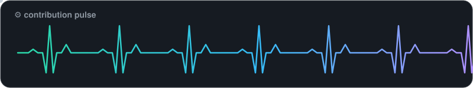

---

## 🐍 Contribution Snake

---

## 📡 Radar Scan

---

## 🎨 More Animations

<b>🖥️ Terminal · Neofetch · Code Window</b>



<b>🌐 Globe · Particles · Circuit Board · Neural Net</b>

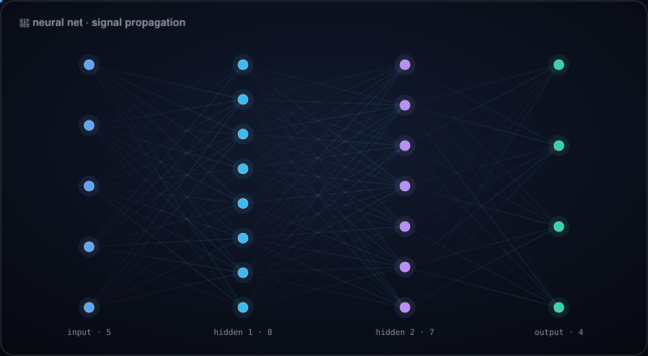

<b>🌧️ Matrix · Fireworks · Conway · DNA</b>


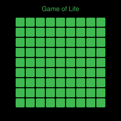

<b>🚀 Rocket · Solar · Atom · Radar · Moon</b>

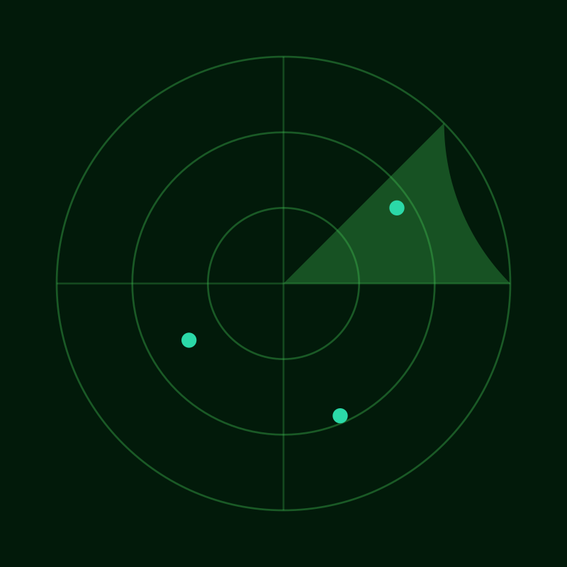

<b>🎵 Music · Coffee · Pac-Man · Octocat · Day/Night</b>


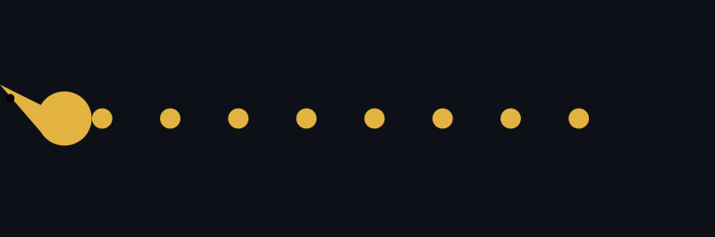

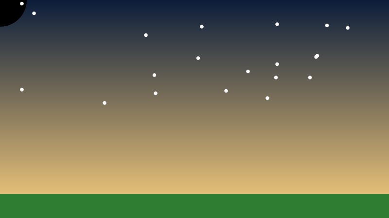

---

## 💬 Fun Corner

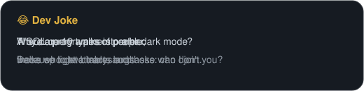

---

## 📦 Packages


<b>How the totals are computed.</b> <b>npm</b>: <code>downloads/point/last-year</code>; the package was first published 2026-08-15, which falls inside that window, so the value is the full lifetime total. <b>PyPI</b>: PyPI's own JSON API reports <code>downloads: -1</code> (stats disabled), so shields.io's <code>pypi/dt</code> badge is permanently "404: badge not found". The figure above sums the per-day counts from pypistats.org, which start exactly at the first upload (2026-08-19), so it is also a full lifetime total. Mirrors are excluded, matching PyPI's official metric — the same one shields.io uses for <code>pypi/dm</code>.

---

## 💭 Currently Exploring

- 🤖 **LLM Agents & Multi-Agent Systems** — autonomous workflows, tool use, eval harnesses
- 🎥 **Generative Video & 3D** — real-time pipelines and asset tooling
- 🦀 **Rust & Systems Programming** — performance-critical internals
- ☸️ **Kubernetes & Cloud Native** — deployment, scaling, observability

---

